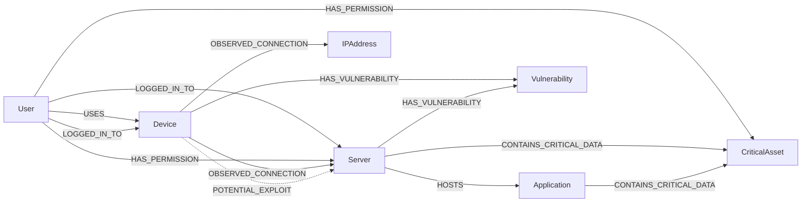

# ThreatLens GraphOps: Graph Schema and API Specification

**Document Version:** 1.0.0  
**Phase:** Phase 2 — Graph Schema and API Contracts  
**Status:** Approved Schema Specification  

---

## 1. Graph Data Model Specification

The ThreatLens GraphOps data model represents enterprise identities, compute and network assets, directory entitlements, vulnerabilities, and high-value "Crown Jewels".

### 1.1 Node Types & Canonical Identity

Every entity imported into the organizational security graph possesses a deterministic, collision-free canonical identifier formatted as `<prefix>:<normalized_key>`.

| Label | Canonical Prefix | Example Canonical ID | Mandatory Properties | Optional Properties | Classification |
| :--- | :--- | :--- | :--- | :--- | :--- |
| `:User` | `user:` | `user:alice@corporation.com`<br>`user:usr-101` | `id`, `user_id`, `email`, `name` | `department`, `role`, `is_service_account`, `is_admin`, `status`, `data` | Identity |
| `:Device` | `device:` | `device:dev-ws-109` | `id`, `device_id`, `hostname`, `ip_address`, `os` | `mac_address`, `subnet`, `is_isolated`, `criticality`, `data` | Endpoint Asset |
| `:Server` | `server:` | `server:srv-app-01` | `id`, `server_id`, `name`, `hostname`, `ip_address` | `tier`, `environment`, `criticality`, `is_isolated`, `data` | Server Asset |
| `:Application`| `app:` | `app:payment-gateway` | `id`, `app_id`, `name` | `version`, `port`, `service_type`, `environment`, `data` | Application |
| `:IPAddress` | `ip:` | `ip:10.0.1.15` | `id`, `ip`, `version` | `scope`, `subnet`, `is_monitored` | Network |
| `:Vulnerability`| `vuln:` | `vuln:CVE-2024-21413` | `id`, `cve_id`, `cvss_score`, `severity` | `description`, `exploit_available`, `patch_available` | Vulnerability |
| `:CriticalAsset`| `critical:` | `critical:crit-db-01` | `id`, `asset_id`, `name`, `category`, `impact_score` | `data_classification`, `owner_department`, `data` | Crown Jewel |
| `:SecurityEvent`| `event:` | `event:evt-8821` | `id`, `event_id`, `event_type`, `severity`, `timestamp` | `case_id`, `provenance`, `data` | Audit / Evidence |

#### Normalization & Duplicate Prevention Rules
1. **Case Normalization:**
   - Vulnerability CVE IDs are uppercase: `vuln:CVE-2024-21413`.
   - Users, devices, servers, apps, critical assets, and events have lowercased suffixes: `user:alice@corp.com`, `device:dev-ws-109`.
   - IP addresses are strictly validated via Python's `ipaddress` library and preserved in canonical representation.
2. **Idempotence & Deduplication:**
   - Database ingestion utilizes `MERGE (n:<Label> {id: $id})` with `ON CREATE SET` and `ON MATCH SET`.
   - Unique constraints on `n.id` are defined for all 8 node labels.

---

### 1.2 Typed Relationships & Directionality

Relationships model actual behavior, directory access permissions, infrastructure hosting, and potential exploit vectors:



#### Valid Endpoints & Semantics

| Relationship Type | Source Label(s) | Target Label(s) | Direction & Meaning | Default Evidence Class |
| :--- | :--- | :--- | :--- | :--- |
| `USES` | `:User` | `:Device` | User regularly operates or is assigned to workstation | `OBSERVED` |
| `LOGGED_IN_TO` | `:User` | `:Server`, `:Device` | Authentication session recorded (interactive or network) | `OBSERVED` |
| `OBSERVED_CONNECTION` | `:Device`, `:Server` | `:Device`, `:Server`, `:IPAddress` | Network session observed via firewall or flow logs | `OBSERVED` |
| `HAS_PERMISSION` | `:User` | `:Server`, `:CriticalAsset`, `:Application` | Active Directory group membership, RBAC, or IAM grant | `AUTHORIZED_ACCESS` |
| `HOSTS` | `:Server` | `:Application`, `:CriticalAsset` | Physical/virtual server runs application or hosts database | `OBSERVED` |
| `RUNS_ON` | `:Server`, `:Application` | `:Device`, `:Server` | Microservice or VM container runs on compute host | `OBSERVED` |
| `HAS_VULNERABILITY` | `:Device`, `:Server`, `:Application` | `:Vulnerability` | Software scanner flagged unmitigated CVE | `OBSERVED` |
| `CONTAINS_CRITICAL_DATA`| `:Server`, `:Application` | `:CriticalAsset` | Direct repository or container of high-value Crown Jewel | `OBSERVED` |
| `POTENTIAL_EXPLOIT` | `:Device`, `:Server` | `:Server` | Unpatched vulnerability provides candidate lateral pivot | `HYPOTHETICAL` |
| `ASSOCIATED_WITH_CASE` | `:User`, `:Device`, `:IPAddress` | `:SecurityEvent` | Links organizational entity to an analyzed ThreatLens case | `OBSERVED` |

---

### 1.3 4-Tier Epistemological Evidence Separation

To avoid confusing active attack execution with directory permissions or theoretical attack vectors, all graph edges and path steps are explicitly labeled:

1. **`OBSERVED`:** Tangible forensic evidence, sensor telemetry, EDR logs, or authentication records (e.g. NetFlow connection, successful Kerberos TGS request, email relay hop).
2. **`AUTHORIZED_ACCESS`:** Valid directory configuration or access entitlement (e.g. member of `Domain Admins`, SQL DB connection permission). *This proves permission exists, not that an attacker exercised it.*
3. **`INFERRED`:** Heuristic correlation or network topology deduction (e.g. subnet broadcast proximity, hostname resolution).
4. **`HYPOTHETICAL`:** Modeled simulation paths, unpatched vulnerability pivots, or "what-if" preconditions without runtime proof of compromise.

---

## 2. API Contracts Specification

All GraphOps endpoints are mounted under prefix `/api/v1/graphops`.

### 2.1 Ingestion Endpoints

#### `POST /api/v1/graphops/ingest/bulk`
Performs atomic, idempotent batch ingestion of organizational entities and relationships.

* **Request Body:** `BulkIngestPayload`
  ```json
  {
    "dataset_name": "corp_infrastructure_q4",
    "entities": {
      "users": [
        { "id": "USR-101", "user_id": "USR-101", "email": "alice@corporation.com", "name": "Alice Johnson", "department": "Finance" }
      ],
      "devices": [
        { "id": "DEV-WS-109", "device_id": "DEV-WS-109", "hostname": "WS-FIN-109", "ip_address": "10.0.1.109", "criticality": "MEDIUM" }
      ],
      "servers": [
        { "id": "SRV-APP-01", "server_id": "SRV-APP-01", "name": "App Server 01", "hostname": "app01.corp", "ip_address": "10.0.2.10", "criticality": "HIGH" }
      ],
      "critical_assets": [
        { "id": "CRIT-DB-01", "asset_id": "CRIT-DB-01", "name": "Customer Financial DB", "category": "FINANCIAL_RECORDS", "impact_score": 95 }
      ]
    },
    "relationships": {
      "relationships": [
        { "source_id": "user:alice@corporation.com", "target_id": "device:dev-ws-109", "relationship_type": "USES", "evidence_class": "OBSERVED" },
        { "source_id": "user:alice@corporation.com", "target_id": "server:srv-app-01", "relationship_type": "HAS_PERMISSION", "evidence_class": "AUTHORIZED_ACCESS" }
      ]
    }
  }
  ```
* **Success Response (200 OK):** `IngestSummaryResponse`
  ```json
  {
    "status": "SUCCESS",
    "dataset_name": "corp_infrastructure_q4",
    "nodes_imported": 4,
    "nodes_updated": 0,
    "nodes_rejected": 0,
    "relationships_imported": 2,
    "relationships_updated": 0,
    "relationships_rejected": 0,
    "errors": [],
    "timestamp": "2026-10-19T23:30:00Z"
  }
  ```
* **Error Response (422 Unprocessable Entity):** Returns Pydantic validation error if CVE format, IP address, or required fields are malformed.

---

### 2.2 Blast-Radius Analytics

#### `GET /api/v1/graphops/blast-radius`
Calculates distinct 1-hop, 2-hop, and 3-hop neighborhoods from a potentially compromised entity.

* **Query Parameters:**
  - `start_node_id` (string, required): e.g. `user:alice@corporation.com`
  - `max_hops` (integer, default `3`, range `1..3`)
  - `direction` (enum, default `OUTGOING`, options: `OUTGOING`, `INCOMING`, `BOTH`)
  - `include_hypothetical` (boolean, default `false`)
* **Success Response (200 OK):** `BlastRadiusResult`
  ```json
  {
    "start_node": {
      "id": "user:alice@corporation.com",
      "label": "User",
      "name": "Alice Johnson",
      "criticality": "LOW"
    },
    "max_hops_evaluated": 3,
    "direction": "OUTGOING",
    "hop_1": {
      "hop_number": 1,
      "node_count": 1,
      "nodes": [
        { "id": "device:dev-ws-109", "label": "Device", "name": "WS-FIN-109", "criticality": "MEDIUM" }
      ],
      "critical_asset_count": 0
    },
    "hop_2": {
      "hop_number": 2,
      "node_count": 1,
      "nodes": [
        { "id": "server:srv-app-01", "label": "Server", "name": "App Server 01", "criticality": "HIGH" }
      ],
      "critical_asset_count": 0
    },
    "hop_3": {
      "hop_number": 3,
      "node_count": 1,
      "nodes": [
        { "id": "critical:crit-db-01", "label": "CriticalAsset", "name": "Customer Financial DB", "criticality": "CRITICAL" }
      ],
      "critical_asset_count": 1
    },
    "total_reachable_nodes": 3,
    "critical_assets_at_risk": [
      {
        "asset_id": "critical:crit-db-01",
        "name": "Customer Financial DB",
        "category": "FINANCIAL_RECORDS",
        "impact_score": 95,
        "hop_depth": 3,
        "shortest_path_nodes": ["user:alice@corporation.com", "device:dev-ws-109", "server:srv-app-01", "critical:crit-db-01"],
        "reachability_status": "EXPOSED"
      }
    ],
    "subgraph_nodes": [ ... ],
    "subgraph_edges": [ ... ],
    "summary_assessment": "Compromise of user:alice@corporation.com exposes 1 high-value Crown Jewel at hop depth 3."
  }
  ```

---

### 2.3 Attack-Path Discovery

#### `POST /api/v1/graphops/attack-paths`
Finds valid bounded paths from an entry point to specified or all high-value critical assets.

* **Request Body:** `AttackPathRequest`
  ```json
  {
    "entry_node_id": "device:dev-ws-109",
    "target_node_ids": ["critical:crit-db-01"],
    "max_depth": 5,
    "include_hypothetical": true
  }
  ```
* **Success Response (200 OK):** `AttackPathResult`
  ```json
  {
    "entry_node": { "id": "device:dev-ws-109", "label": "Device", "name": "WS-FIN-109" },
    "total_paths_discovered": 1,
    "paths": [
      {
        "path_id": "PATH-001",
        "target_id": "critical:crit-db-01",
        "target_name": "Customer Financial DB",
        "length": 2,
        "risk_score": 85,
        "nodes": [ ... ],
        "steps": [
          {
            "step_number": 1,
            "source_id": "device:dev-ws-109",
            "target_id": "server:srv-app-01",
            "relationship_type": "LOGGED_IN_TO",
            "evidence_class": "OBSERVED",
            "provenance": "Windows Security Log 4624",
            "description": "Active cached logon session from workstation"
          },
          {
            "step_number": 2,
            "source_id": "server:srv-app-01",
            "target_id": "critical:crit-db-01",
            "relationship_type": "CONTAINS_CRITICAL_DATA",
            "evidence_class": "OBSERVED",
            "provenance": "Database Inventory",
            "description": "Server hosts financial database repository"
          }
        ],
        "observed_steps_count": 2,
        "hypothetical_steps_count": 0,
        "assumptions": [
          "Attacker steals local session credentials on WS-FIN-109 to authenticate against App Server 01."
        ]
      }
    ],
    "targets_reached": ["critical:crit-db-01"],
    "methodology_note": "Candidate paths discovered via directed traversal. Paths containing HYPOTHETICAL steps represent potential vectors, not proof of attacker movement."
  }
  ```

---

### 2.4 Choke-Point Analysis

#### `GET /api/v1/graphops/choke-points`
Analyzes attack vectors to identify intermediate nodes or edges that eliminate the maximum number of attack paths.

* **Query Parameters:**
  - `top_n` (integer, default `5`, range `1..20`)
* **Success Response (200 OK):** `ChokePointResult`
  ```json
  {
    "total_paths_analyzed": 5,
    "choke_points": [
      {
        "rank": 1,
        "entity_id": "server:srv-app-01",
        "entity_label": "App Server 01",
        "entity_type": "Server",
        "paths_traversed_count": 4,
        "traversal_percentage": 80.0,
        "affected_critical_assets": ["critical:crit-db-01", "critical:crit-pii-02"],
        "recommended_action": "ISOLATE_NODE",
        "intervention_details": "Isolating server:srv-app-01 cuts off 80% of inbound lateral paths to core databases."
      }
    ],
    "top_recommendation": { ... },
    "explanation": "Calculated path intersection across candidate attack vectors."
  }
  ```

---

### 2.5 What-If Containment Simulator

#### `POST /api/v1/graphops/simulate-containment`
Evaluates proposed mitigations (isolate node, revoke permission, sever connection) strictly in memory without altering the live graph.

* **Request Body:** `ContainmentSimulationRequest`
  ```json
  {
    "entry_node_id": "device:dev-ws-109",
    "target_asset_ids": ["critical:crit-db-01"],
    "proposed_interventions": [
      {
        "action": "ISOLATE_NODE",
        "node_id": "server:srv-app-01",
        "rationale": "Sever primary lateral bridge server"
      }
    ]
  }
  ```
* **Success Response (200 OK):** `ContainmentSimulationResult`
  ```json
  {
    "simulation_id": "SIM-2026-1019-01",
    "timestamp": "2026-10-19T23:31:00Z",
    "live_graph_modified": false,
    "proposed_interventions": [ ... ],
    "baseline_paths_count": 4,
    "remaining_paths_count": 0,
    "paths_eliminated_count": 4,
    "containment_efficiency_pct": 100.0,
    "path_statuses": [
      {
        "path_id": "PATH-001",
        "target_id": "critical:crit-db-01",
        "status": "ELIMINATED",
        "severed_at_step": "server:srv-app-01 isolated"
      }
    ],
    "residual_exposed_assets": [],
    "analyst_verdict": "Complete containment achieved. All 4 candidate paths to Customer Financial DB eliminated.",
    "safety_disclaimer": "SIMULATION ONLY: No actual permissions were revoked, no devices were disconnected, and no live infrastructure was modified."
  }
  ```

---

### 2.6 Email Investigation Case Bridge

#### `GET /api/v1/graphops/case-bridge/{case_id}`
Bridges verified entities from an analyzed ThreatLens case into the enterprise organizational graph.

* **Path Parameters:** `case_id` (e.g. `MT-101`)
* **Success Response (200 OK):** `CaseBridgeResponse`
  ```json
  {
    "case_id": "MT-101",
    "primary_compromised_node": {
      "id": "user:victim1@corporation.com",
      "label": "User",
      "name": "Victim 1"
    },
    "mapped_entities": [
      {
        "evidence_type": "RECIPIENT_EMAIL",
        "raw_value": "victim1@corporation.com",
        "mapped_node_id": "user:victim1@corporation.com",
        "node_label": "User",
        "match_confidence": 1.0,
        "match_rationale": "Exact verified recipient address matches Active Directory user"
      }
    ],
    "unmapped_external_iocs": [
      "185.190.140.22",
      "alert-center.xyz",
      "http://secure-login.alert-center.xyz/auth/verify"
    ],
    "recommended_blast_radius_url": "/api/v1/graphops/blast-radius?start_node_id=user:victim1@corporation.com"
  }
  ```

---

## 3. Documented Open Design Decisions

In accordance with instruction 10, the following technical and architectural decisions are explicitly documented for stakeholder visibility:

1. **Directionality of Network Telemetry (`OBSERVED_CONNECTION`):**
   - *Current Design:* Directed from source host initiating connection to destination host/IP (`device -> server`).
   - *Decision:* For blast-radius calculations, analysts can select traversal direction (`OUTGOING`, `INCOMING`, or `BOTH`). Default is `OUTGOING` for lateral movement propagation.
2. **Attribution Boundary for External Threat Infrastructure:**
   - *Current Design:* External IPs (e.g. C2 infrastructure `185.190.140.22`) and deceptive domains (e.g. `alert-center.xyz`) extracted from emails are **never** imported into the organizational graph as internal nodes.
   - *Decision:* External IOCs remain in the ThreatLens case investigation model (`backend/models/graph.py`); only verified corporate identities/hosts bridge into GraphOps.
3. **Simulation Ephemerality vs Live Infrastructure Isolation:**
   - *Current Design:* What-if simulation runs 100% in memory or via virtual projection. `live_graph_modified` is strictly enforced as `False`.
   - *Decision:* SOC analysts will not have automated API authority to execute real active directory account deactivations or firewall port shutdowns directly from GraphOps. Containment simulations will provide actionable copy-paste remediation orders for change-management execution.
